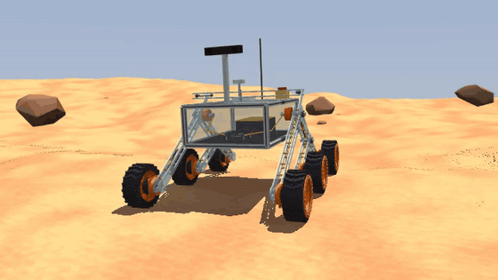
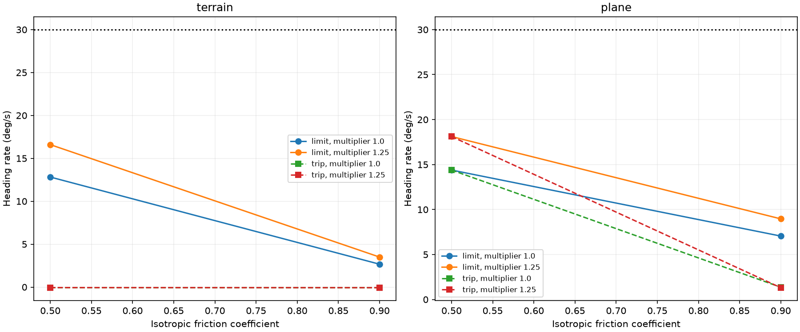
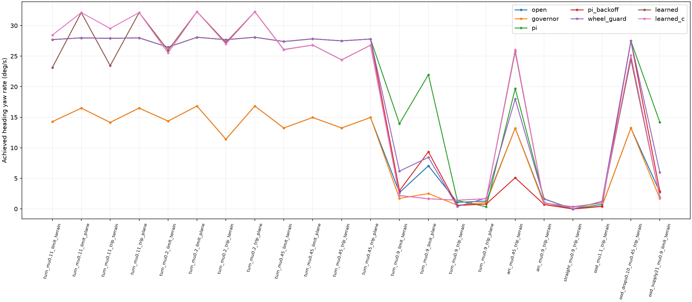

# rover-sim

A MuJoCo model of the drivebase of our SSS (UC Davis Space and Satellite Systems)
University Rover Challenge rover, with the six hub motors, the shared battery and
the motors' CAN frames modeled, so the drive electronics can be tested before the
hardware is ready.



*The rocker-bogie model driving over a rock at 0.5 m/s with a plain per-wheel speed
loop. ([mp4](media/rover_drive.mp4))*

## What it does

- Builds the rocker-bogie from the team's rover design: paired acrylic
  rocker and bogie plates, a differential bar, six DM-J6006-2EC hub motors, printed
  wheels, and the electronics box with the team's control board inside. The
  parameters, with their sources or assumptions, are in [viz/ROVER_PARAMS.md](viz/ROVER_PARAMS.md).
- Models the drive electronics at 1 kHz: the motor from the manual's parameter
  table, the driver's current setting (limit or trip), the 15 V undervoltage latch,
  a shared 6S battery that sags under load, and CAN velocity frames with delay and
  drops, encoded the way the manual specifies.
- Runs drive tests on generated terrain: straight runs, a rock under one side, a
  ramp hold, turning in place, and what happens when the commands stop.
- Compares hand-designed turn controllers with a small learned one (PPO) on 22 fixed
  test cases, and exports the learned policy to float32 C for a Cortex-M4.

## Results



Turning in place at a 30 deg/s command is the hard case. The turn rate falls as
friction rises because the most loaded wheel sits at the driver's 9.8 A setting, and
if that setting trips instead of limiting (dashed), the wheel drops out and the turn
nearly stops. [docs/FINDINGS.md](docs/FINDINGS.md) goes through the load
transfer and the motor model.



A small PPO policy matched the gyro yaw loop's average turn rate on the low- and
medium-friction cases with fewer driver trips, but it tracked worse and mostly
stopped turning on high friction, so it is a different trade-off rather than a
better controller. Terrain cases also gave different numbers on Windows and Linux,
so comparisons stay on one machine. [docs/FINDINGS.md](docs/FINDINGS.md)

## Running it

Python 3.12 with mujoco 4.0, numpy, trimesh, shapely, mapbox-earcut,
fast_simplification and imageio (torch and stable-baselines3 for `rl/`):

```
cd viz
python build_rover.py          # scene/rover_scene.xml, meshes and terrain
python preview_rover.py        # settles, drives over a rock, writes stills to viz/out/
python -m mujoco.viewer --mjcf scene/rover_scene.xml
cd ..
python -m pytest tests -q
python -m experiments.run_all  # the drive cases, into results/
python -m experiments.r3       # datasheet motor model and turning trials
```

The learned-controller runs can be replayed in a browser: run
`python viz/web/export_glb.py` once, then `python viz/web/server.py results/r4/replay`
and open http://localhost:8791.

The control board meshes come from the team's KiCad project and are not in this
repo; without them `build_rover.py` uses a plain 100 x 100 mm board.
[docs/BUILD.md](docs/BUILD.md) has the export steps and the other experiment
commands.

## Limits

- Simulation only. Nothing here has run on the real motors, a CAN bus or the team's
  ROS2 code.
- Masses, the sizes the team hasn't published (wheel size, track, electronics box)
  and the ground friction are assumptions or published proxies until the team's CAD
  and measurements are available.
- Whether the real driver limits current at its setting or trips isn't confirmed, so
  both cases are simulated.
- The rover's design and motor choice are the team's; this repo is
  my model of them.
